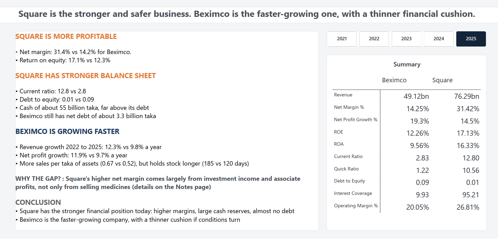

# Square_Beximco_Dashboard
# Beximco vs Square: Financial Analysis (2021 to 2025)

A Power BI dashboard comparing two Bangladeshi pharmaceutical companies, Beximco and Square, using five years of their published financial statements.



## The question
Which of the two companies is financially stronger, and what drives the difference?

## Key findings (2025)
| | Beximco | Square |
|---|---|---|
| Revenue | 49.1bn taka | 76.3bn taka |
| Net margin | 14.2% | 31.4% |
| Return on equity | 12.3% | 17.1% |
| Current ratio | 2.83 | 12.80 |
| Debt to equity | 0.09 | 0.01 |
| Revenue growth (CAGR 2022 to 2025) | 12.3% | 9.8% |

- **Square has the stronger financial position:** higher margins, a large cash reserve, almost no debt.
- **Beximco is growing faster in percentage terms,** though Square is larger and adds more taka of revenue each year.
- **What drives the gap:** at the operating level the margin gap is modest (26.8% vs 20.0%). The bigger net margin gap comes from Square's investment income and share of associate profits, roughly two-fifths of its profit. Part of Square's strength comes from its investments, not only from selling medicines.

## Dashboard pages
| Page | What it shows |
|---|---|
| Growth | Revenue trend, year-on-year growth, CAGR |
| Profitability | Gross, operating and net margin, ROE and ROA |
| Financial health | Current and quick ratio, debt to equity, interest coverage, operating cash flow, net debt |
| Efficiency | Inventory days, receivable days, asset turnover |
| Verdict | Summary table and the answer to the question |
| Notes | Data, definitions, caveats |

[Dashboard pages](Screenshot/)

## How it was built
1. **Data preparation:** converted the financial statements from PDF to Excel, then recalculated every subtotal and total across all sheets. This found missing subtotals and blank lines, which were fixed and documented.
2. **Tidy table:** unpivoted all statements into one long table (884 rows) with matching line item names for both companies, so one measure works for either.
3. **Measures:** wrote DAX measures for growth, profitability, liquidity and efficiency.
4. **Report:** built five analysis pages in Power BI with a custom theme.

Example measure:
```
Net Margin % = DIVIDE([Net Profit], [Revenue])
```

## Definitions
- **Operating margin:** operating profit divided by revenue. Square's operating profit excludes other operating income so it matches Beximco's definition.
- **Net margin:** profit for the period divided by revenue.
- **ROE and ROA:** profit for the period divided by year-end total equity or total assets.
- **Debt:** long term borrowings (current and non-current) plus short term borrowings. Net debt is debt minus cash.
- **Inventory days:** 365 divided by (cost of goods sold divided by inventories). **Receivable days:** receivables divided by revenue, times 365.

## Repository contents
| File | Description |
|---|---|
| `Square_Beximco_Dashboard.pbix` | The Power BI report |
| `Square_Beximco_Dashboard.pdf` | PDF export of all pages |

To explore it, open the `.pbix` file in Power BI Desktop (free).

## Limits and caveats
- Growth is measured from 2022 because Beximco's 2022 results include an acquired subsidiary, so 2021 is not fully comparable.
- Square's 2024 and 2025 gross revenue and VAT are derived from the cash flow statement, not reported. They do not affect any ratio, which uses net revenue.
- Square's interest coverage is very high because its finance cost is tiny.
- The analysis covers 2021 to 2025 and does not predict future performance.
- This is a learning project, not investment advice.

## Source
Published financial statements of Beximco and Square, 2021 to 2025. [Add links to where you downloaded them.]
##AI Agent: Claude has been used as primary agent to support the overall procedures

## About
Built by Joy Denish Rodrigues, an accounting student learning data analytics. [LinkedIn link](https://www.linkedin.com/posts/joy-rodrigues-_beximco-vs-square-five-years-of-financials-ugcPost-7519765718058328064-TnOq/?highlightedUpdateUrn=urn%3Ali%3Aactivity%3A7519765721153835008&highlightedUpdateType=SOCIAL_SHARE&origin=SOCIAL_SHARE)
